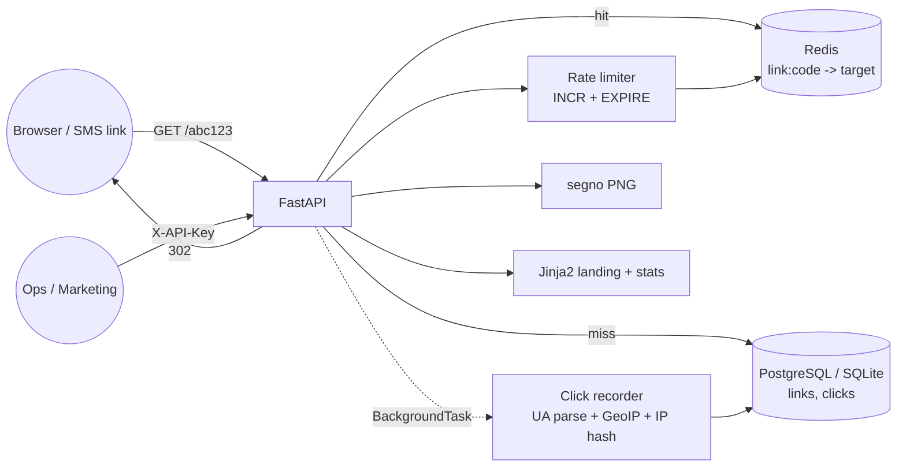

# URL Shortener with Analytics

A small, complete FastAPI service that turns long URLs into short codes and tells you who clicked them.

[](https://github.com/AkibUllah/url-shortener-analytics/actions/workflows/ci.yml)


## Why this exists

Every campaign I have shipped for e-commerce and payment clients needed trackable links: an Eid offer sent over SMS, a bKash cashback banner, a QR code on a shop counter. Third-party shorteners leak click data to someone else and die when the free tier changes. This service is the self-hosted version: a redirect hot path that stays fast under load (Redis cache, no DB hit on repeat clicks), click analytics that are useful without storing personal data (IPs are keyed-hashed), and the operational extras (expiry, passwords, QR codes, rate limiting, API keys) that always get requested the week after launch.

## Features

- Base62 short codes derived from the DB sequence through a bijective permutation, so they are unique without lookups and not guessable in order; custom aliases with reserved-word checks and collision retry
- 302 redirects served from Redis (or an in-process cache when Redis is absent) with TTL clamped to link expiry
- Link expiry (`expires_at` or `expires_in_seconds`) returning `410 Gone`, soft delete returning `404`
- Password-protected links with a PBKDF2 hash and a server-rendered unlock form
- QR code PNG for every link (`segno`, configurable scale)
- Click tracking in a background task: timestamp, referrer host, browser / OS / device classification, country via a pluggable GeoIP resolver (stub table included; MaxMind drops in), keyed IP hash for unique-visitor counts
- Analytics endpoint: clicks by day (zero-filled), top referrers, browsers, operating systems, devices, countries
- Fixed-window rate limiting per client IP with `X-RateLimit-*` and `Retry-After` headers, shared across replicas through Redis
- Static API key on management endpoints; public redirect, QR and stats page
- Jinja2 landing page (`/`) and a public stats page at `/<code>+`, plus OpenAPI docs at `/docs`
- `/health` reporting DB and cache status; Dockerfile with non-root user and healthcheck; docker-compose with Postgres 16 and Redis 7

## Architecture



Key decisions:

- **Redirect hot path never waits on analytics.** The redirect response is returned first; click parsing and the `INSERT` run in a FastAPI `BackgroundTask` with its own session, and any failure is logged rather than surfaced to the visitor.
- **Codes come from the sequence, not from random retries.** `code_for_id(id)` applies an affine permutation modulo 2^40 before base62 encoding. Uniqueness is structural; the only collision possible is with a user-chosen alias, handled by one `IntegrityError` retry loop with a random suffix.
- **Cache and rate limiter share one `Cache` protocol** (`get/set/delete/incr/ping`). `RedisCache` is used in production, `MemoryCache` with an injectable clock in tests and single-node deployments. Tests also exercise the Redis code path through `fakeredis`.
- **Privacy by default.** Raw IPs are never stored; a keyed SHA-256 hash lets analytics count unique visitors without being able to reverse to an address. GeoIP resolution is behind a `GeoIPResolver` protocol with a `NullGeoIP` default.
- **Soft deletes.** Deactivated links keep their click history for reporting and their code is never reissued.

## Tech Stack

| Layer | Choice |
|---|---|
| API | FastAPI 0.115, Pydantic v2, pydantic-settings |
| Persistence | SQLAlchemy 2.0 (SQLite for dev/tests, PostgreSQL 16 via psycopg 3 in compose) |
| Cache / rate limit | Redis 7 (redis-py), `fakeredis` in tests, in-memory fallback |
| Templates | Jinja2, plain CSS, no JS build step |
| QR | segno |
| Tooling | pytest, ruff, GitHub Actions (3.10 / 3.11 matrix + docker build) |

## Quick Start

### Docker Compose (Postgres + Redis)

```bash
git clone git@github.com:AkibUllah/url-shortener-analytics.git
cd url-shortener-analytics
cp .env.example .env            # set SHORTENER_API_KEY and SHORTENER_IP_HASH_SECRET
docker compose up --build -d
curl -s localhost:8000/health
```

### Local (SQLite, in-memory cache)

```bash
make install                    # creates .venv and installs with dev extras
make run                        # http://localhost:8000
```

Create a link and follow it:

```bash
curl -s -X POST localhost:8000/api/v1/links \
  -H "X-API-Key: dev-api-key-change-me" -H "Content-Type: application/json" \
  -d '{"url": "https://shop.example.com/eid-sale?utm_source=sms", "alias": "eid-sale", "expires_in_seconds": 604800}'
# {"code":"eid-sale","short_url":"http://localhost:8000/eid-sale", ...}

curl -i localhost:8000/eid-sale            # HTTP/1.1 302 Found, Location: https://shop.example.com/...
curl -s localhost:8000/api/v1/links/eid-sale/analytics -H "X-API-Key: dev-api-key-change-me" | jq .
curl -o eid-sale.png localhost:8000/api/v1/links/eid-sale/qr
```

## API

| Method | Path | Auth | Description |
|---|---|---|---|
| `POST` | `/api/v1/links` | API key | Create a link (`url`, optional `alias`, `title`, `password`, `expires_at` or `expires_in_seconds`) |
| `GET` | `/api/v1/links?limit=&offset=` | API key | List links, newest first |
| `GET` | `/api/v1/links/{code}` | API key | Link details including `click_count` |
| `DELETE` | `/api/v1/links/{code}` | API key | Deactivate a link and evict it from the cache |
| `GET` | `/api/v1/links/{code}/analytics?days=30&top=10` | API key | Clicks by day, referrers, browsers, OS, devices, countries, unique visitors |
| `GET` | `/api/v1/links/{code}/qr?scale=6` | public | QR code PNG pointing at the short URL |
| `GET` | `/{code}` | public, rate limited | 302 redirect; 404 unknown/inactive, 410 expired, 200 unlock form when password protected |
| `POST` | `/{code}` | public, rate limited | Submit password (`application/x-www-form-urlencoded`), 302 on success, 401 otherwise |
| `GET` | `/{code}+` | public | HTML stats page |
| `GET` | `/` and `POST /shorten` | public, rate limited | Landing page and form-based shortening |
| `GET` | `/health` | public | `{status, database, cache, version}` |
| `GET` | `/docs`, `/openapi.json` | public | OpenAPI |

Configuration is read from environment variables prefixed with `SHORTENER_`; see [`.env.example`](.env.example).

## Project Structure

```
shortener/
├── main.py           # create_app() factory, wiring of cache / geoip / rate limiter
├── config.py         # pydantic-settings
├── db.py             # engine + session factory (SQLite StaticPool for tests)
├── models.py         # Link, Click
├── schemas.py        # request/response models, alias validation
├── services.py       # LinkService: create with collision handling, record_click
├── analytics.py      # aggregation queries
├── base62.py         # encode/decode + id permutation
├── cache.py          # Cache protocol, MemoryCache, RedisCache
├── ratelimit.py      # fixed-window limiter on top of Cache
├── ua.py             # user-agent classifier
├── geoip.py          # GeoIPResolver protocol, StaticGeoIP stub, NullGeoIP
├── security.py       # PBKDF2 passwords, IP hashing, API key dependency
├── deps.py           # FastAPI dependencies bound to app.state
├── routers/          # links (management), redirect, pages, health
├── templates/        # base, index, password, stats
└── static/style.css
tests/                # 61 tests
Dockerfile · docker-compose.yml · Makefile · .github/workflows/ci.yml
```

## Testing

```bash
make test        # pytest, SQLite in-memory + fakeredis, no services required
make lint        # ruff check + ruff format --check
```

Covered: base62 round-trips and permutation bijectivity, password and IP hashing, user-agent classification across desktop / mobile / tablet / bot, GeoIP stub, cache TTL and counter semantics on both backends, rate-limit window rollover, link creation (generated, custom alias, duplicate, reserved, invalid URL), forced code collision retry, redirect / 404 / 410 / cache hit / soft delete eviction, password flow, 429 behaviour, QR PNG signature, analytics aggregation and zero-filled day series, landing and stats pages, health and OpenAPI.

## Roadmap

- Real GeoIP via `geoip2` + GeoLite2 behind the existing `GeoIPResolver` protocol
- Per-key API tokens with scopes instead of one static key, and per-link ownership
- Alembic migrations once the schema stops being `create_all`-friendly
- Bulk CSV import/export for campaign teams
- Click event export to Parquet for longer-term analysis outside Postgres

## License

MIT. See [LICENSE](LICENSE).
